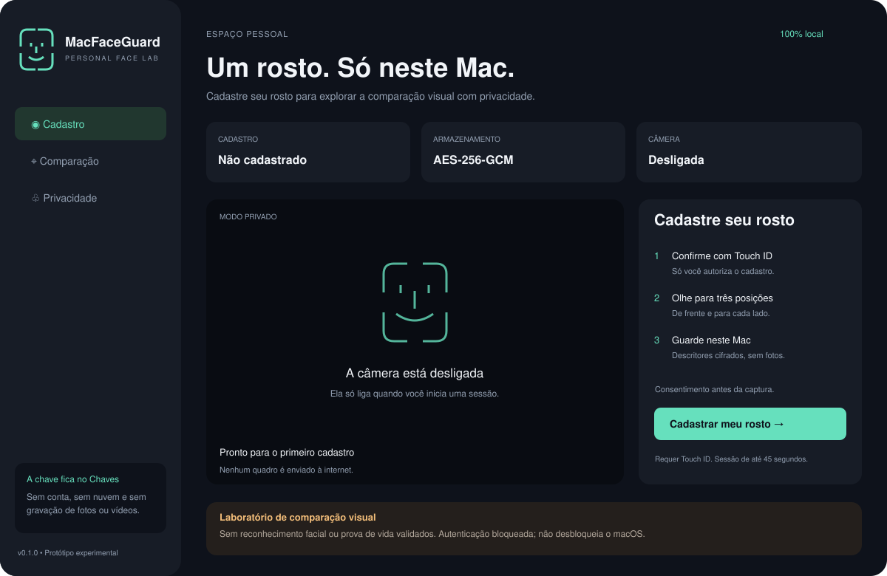

# MacFaceGuard

Laboratório nativo de cadastro facial local para macOS. Interface em português, câmera integrada sob consentimento, três posições de captura, descritores protegidos por AES-256-GCM e chave no Chaves com Touch ID.



*Ilustração representativa da interface implementada, sem imagens ou dados pessoais; não é captura de tela.*

## Estado real: v0.1.4 experimental

O app permite **cadastrar descritores visuais do rosto** e comparar a distância entre imagens usando `VNGenerateImageFeaturePrintRequest` da Apple. Feature prints são descritores de imagem genéricos: **não são um modelo de reconhecimento de identidade facial**. Não há limiar de identidade, taxa de erro medida ou detector anti-spoofing validado. A decisão de autenticação permanece bloqueada, mesmo se duas imagens forem semelhantes.

Não desbloqueia o macOS, não substitui Touch ID, senha ou FileVault e não solicita nem guarda a senha do Mac. Uma webcam RGB não oferece as garantias do Face ID. Veja [o estado e a validação](reports/STATUS_FINAL.md).

> **Situação atual:** a versão 0.1.4 foi instalada com perfil Apple e opera na barra de menus, sem Dock. Assinatura e autoverificação da proteção do Chaves passaram; a interface confirmou cadastro local encontrado. O reconhecimento de identidade e o desbloqueio do macOS continuam sem implementação. O cadastro completo não foi decifrado pelo desenvolvedor.

## O que ocorre ao bloquear ou reiniciar o Mac

O aplicativo não autentica a tela de bloqueio nem substitui a senha/Touch ID. A abertura automática inicia o app depois de entrar no macOS; a câmera permanece desligada. Cadastro criptografado e comparação visual são operações do próprio app. O adaptador real continua recusando autenticação porque não há modelo facial ou PAD validado.

## Barra de menus

O MacFaceGuard fica no ícone de rosto na barra superior do macOS, sem ícone no Dock. Clique nele e escolha **Abrir MacFaceGuard** para cadastrar ou comparar. Fechar a janela mantém o ícone disponível; **Sair** encerra o app. Reiniciar não habilita desbloqueio facial.

## Primeiro cadastro

1. Abra `MacFaceGuard.app` no Mac.
2. Em **Cadastro**, marque o consentimento e clique **Cadastrar meu rosto**.
3. Confirme com Touch ID e autorize a câmera no diálogo do macOS.
4. Olhe de frente e depois levemente para cada lado. O cadastro expira em 90 segundos; as instruções e setas aparecem sobre a câmera, com confirmação sonora por amostra.
5. O app confirma quando os três descritores forem criptografados. A câmera desliga.

Em **Comparação**, confirme o consentimento e o Touch ID para observar a distância visual. Um valor menor indica maior semelhança de imagem, sem validar identidade. Em **Privacidade**, é possível excluir cadastro e chave, abrir a configuração da câmera e controlar a abertura no login.

## Privacidade

- Fotos e vídeos não são gravados. Os quadros são processados em memória.
- O único cadastro persistente fica em `~/Library/Application Support/MacFaceGuard/private/enrollment.aesgcm`, fora do projeto, do OneDrive e do Git.
- Diretório `0700`, arquivo `0600`, escrita atômica e marcação de exclusão de backup. Outros programas que ignoram essa marcação podem copiar o arquivo.
- Chave AES de 256 bits no Chaves, sem sincronização, com `WhenUnlockedThisDeviceOnly` e controle `biometryCurrentSet`. Alterar o conjunto de digitais pode invalidar o acesso: exclua o cadastro e cadastre novamente.
- O repositório contém apenas código, testes, documentação e recursos ilustrativos. Não há telemetria, contas, servidor, SDK de terceiros ou código de envio de dados.
- A inicialização automática abre o app com a câmera **desligada**. Câmera somente após uma ação sua; encerra ao sair do app, fechar a janela, suspender o Mac ou atingir 90 segundos no cadastro / 45 na comparação.

## Compilar

Requer macOS 15+, Xcode/Swift 6+, conta Apple de desenvolvimento configurada no Xcode, certificado/perfil válido e Touch ID. Os controles biométricos do Chaves precisam de autorização na assinatura; uma assinatura ad hoc não serve para esse fluxo. Não há pacotes nem modelos externos para baixar.

```bash
swift test
bash scripts/build-app.sh
unzip -q dist/MacFaceGuard.zip -d /tmp/MacFaceGuard-run
open /tmp/MacFaceGuard-run/MacFaceGuard.app
```

O script compila pelo projeto Xcode com assinatura Apple Development e perfil de provisionamento, verifica a proteção do Chaves com um item sintético e só então gera `dist/MacFaceGuard.zip`. O ZIP evita que metadados de pastas sincronizadas invalidem o pacote. Extraia fora do OneDrive/iCloud. Não inclui Developer ID nem notarização. A compilação usa a arquitetura do Mac atual. A política de confiança do macOS continua ativa.

Para instalar para o usuário atual, copie o `.app` para `~/Applications`. Ative **Abrir MacFaceGuard ao entrar no macOS** em **Privacidade** se desejar. A versão é de desenvolvimento, sem notarização. O perfil e os certificados locais não pertencem ao Git; o script reutiliza a identidade Apple já instalada.

## Testes e limites

Os testes cobrem política de recusa, cifra/decifra, nonce aleatório, chave incorreta, adulteração, truncamento, validação do registro e limites de pose. Não substituem ensaios humanos, teste de câmera/Touch ID, avaliação de ataques ou auditoria independente. Não há métricas FMR/FNMR/APCER/BPCER publicadas porque não foram medidas.

As especificações originais do kit em `docs/` descrevem etapas futuras. O escopo implementado e os bloqueios estão em `reports/STATUS_FINAL.md`, e o mapa do código em [.ai/PROJECT_MAP.md](.ai/PROJECT_MAP.md).

## Remover

Em **Privacidade**, exclua o cadastro com Touch ID e desative a abertura no login. Encerre o app e remova sua cópia de `~/Applications`. Apagar apenas o aplicativo ou o repositório não exclui o cadastro nem a chave. Se a biometria do sistema foi redefinida e impede a exclusão pelo app, apague o item `com.macfaceguard.local.template-key.v1` no aplicativo Chaves e o arquivo privado acima, sem remover outros itens.

## Fontes

- [AVFoundation: autorização da câmera](https://developer.apple.com/documentation/avfoundation/requesting-authorization-to-capture-and-save-media)
- [Vision: feature prints de imagem](https://developer.apple.com/documentation/vision/vngenerateimagefeatureprintrequest)
- [CryptoKit: AES-GCM](https://developer.apple.com/documentation/cryptokit/aes/gcm)
- [LocalAuthentication: LAContext](https://developer.apple.com/documentation/localauthentication/lacontext)
- [ServiceManagement: SMAppService](https://developer.apple.com/documentation/servicemanagement/smappservice)
- [Avaliação das referências open source](reports/avaliacao-open-source.md)

Licença MIT para o código deste projeto. Frameworks Apple seguem seus próprios termos. Nenhum peso de terceiros é incluído.
